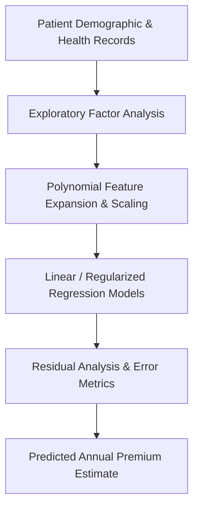

# Medical Insurance Cost Predictive Regression

> Statistical modeling framework forecasting individual medical insurance charges from health indicators.

[](https://github.com/sohailahmed-bsrh/medical-insurance-cost-prediction)
[](https://sohail.devsil.com/projects.html)
[](https://sohail.devsil.com)

---

## Overview

Insurance underwriters require accurate cost predictions based on demographic risk factors like smoking, BMI, and age.

This project provides an end-to-end, reproducible implementation engineered to solve this challenge through verified data transformations, reliable algorithms, and production-ready architecture.

---

## Key Features

- Univariate and bivariate statistical analysis exploring health risk determinants
- Linear, Ridge, and Polynomial regression modeling estimating healthcare claims
- Residual analysis evaluating heteroscedasticity and model assumptions
- Mean Absolute Error (MAE) and R-squared metric benchmarking

---

## System Architecture



---

## Technology Stack

| Technology | Version / Spec | Role in Architecture |
| :--- | :--- | :--- |
| **Python** | `3.10+` | Scientific calculation runtime |
| **Scikit-learn** | `1.3+` | Regression estimators, cross-validation, and metrics |
| **Pandas & NumPy** | `2.0+` | Data transformations and mathematical arrays |
| **Seaborn** | `0.12+` | Regression scatter plots with trend confidence intervals |

---

## Repository Structure

```text
medical-insurance-cost-prediction/
|-- dataset/
|   `-- insurance.ipynb
|-- notebooks/
|-- data/
|-- .gitignore
|-- requirements.txt
`-- README.md
```

---

## Installation and Execution

### Prerequisites
- Python 3.10 or higher
- Git version control
- Virtual environment manager (`venv`)

### Setup Instructions
1. Clone the repository:
```bash
git clone https://github.com/sohailahmed-bsrh/medical-insurance-cost-prediction.git
cd medical-insurance-cost-prediction
```

2. Configure environment and dependencies:
```bash
python -m venv venv
source venv/bin/activate  # On Windows: venv\Scripts\activate
pip install -r requirements.txt
jupyter notebook
```

---

## Interface and Verification
The system produces verifiable execution logs, prediction matrices, or interactive browser interfaces depending on the target mode. Verify operation by executing the commands specified above or inspecting the demonstration notebooks.

---

## Author and Contact
Developed by **Sohail Ahmed** — Full Stack AI Engineer & Machine Learning Specialist.
- **Portfolio:** [sohail.devsil.com](https://sohail.devsil.com)
- **GitHub:** [@sohailahmed-bsrh](https://github.com/sohailahmed-bsrh)
- **Email:** [sohail.bsrh@gmail.com](mailto:sohail.bsrh@gmail.com)

---

## Author & Contact Information

<table width="100%" align="center">
  <tr>
    <td align="center" style="padding: 20px;">
      <h3>Sohail Ahmed</h3>
      <p><strong>Full-Stack Artificial Intelligence & Computer Vision Engineer</strong></p>
      <p>
        <a href="https://sohail.devsil.com"></a>
        <a href="https://github.com/sohailahmed-bsrh"></a>
        <a href="https://linkedin.com/in/sohail-ahmed-dev"></a>
        <a href="mailto:sohail.bsrh@gmail.com"></a>
      </p>
      <p><em>Available for technical roles in Artificial Intelligence, Computer Vision, and Full-Stack Engineering.</em></p>
      <hr style="border: 0; height: 1px; background: #30363d; margin: 15px 0;">
      <small>Distributed under the MIT License.</small>
    </td>
  </tr>
</table>
